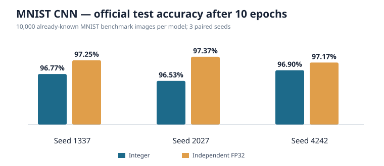

# MNIST CNN — frozen 10-epoch official benchmark, October 25, 2026

**Status:** completed explicitly opt-in final-test benchmarking for [#35](https://github.com/philsupertramp/integers/issues/35) / [PR #36](https://github.com/philsupertramp/integers/pull/36). **Do not mistake this for a pristine unseen holdout:** the official MNIST 10k test set was already evaluated during dense MLP [#15](https://github.com/philsupertramp/integers/issues/15). The CNN was not further tuned using these results. This is an **already-known standardized benchmark**.

This independent final training run used the unchanged frozen CNN configuration and original source-code commit `ce1e9975b0d3ca7ca98e1a54548cb9f32be4cf02`. It starts from seed-initialized weights, runs a fixed ten epochs and evaluates the official MNIST test **once per paired backend/seed** after epoch 10. The preceding **validation-only** evidence is archived [separately](../../validation-only/2026-10-24-10epoch-ce1e9975/README.md); it has not been overwritten.

## Original evidence and plots

The **nine** uploaded source files are preserved byte-for-byte (uploaded duplicate suffix `(3)` removed from their repository filenames):

- Full ten-epoch JSON run reports: `integer-seed-{1337,2027,4242}.json` and `fp32-seed-{1337,2027,4242}.json`.
- [Original manifest.json](manifest.json) with all **four** canonical IDX SHA-256 checksums and exact platform/compiler/commit details.
- [Original summary.md](summary.md) with the submitted aggregate results.
- [Original validation_accuracy.svg](validation_accuracy.svg), identical in Git blob content to the earlier validation-only plot.



[official_test_accuracy.svg](official_test_accuracy.svg) was **generated after** the submitted experiment, using the recorded one-time test scores, and is not an originally submitted output.

The small [experiment-files.tar.xz](experiment-files.tar.xz) losslessly packages the **nine original submitted files**, without data/model checkpoints or a training log (none was supplied in this final batch). To extract from the repository root:

```sh
tar -xJf reports/held_out/mnist/cnn/full/2026-10-25-locked-ce1e9975/experiment-files.tar.xz
```

Archive SHA-256: `dfeedfe6dd92489286f16d6709cbd32c289fbbd6f509ddf6569e8e8293ca1827`. Every one of the nine original source files has a Git blob SHA exactly matching the maintainer-provided bytes. Files were validated for internal consistency: each run has 10 epochs, each confusion matrix has 10 × 500 validation examples, class recalls and prediction totals agree, official test correct counts match the accuracy percentages, and there are no missing seeds.

## Fixed workload, original provenance

- Channel-first Conv(1→4,valid3) → ReLU → MaxPool(2) → Conv(4→8,valid3) → ReLU → MaxPool(2) → Flatten(200) → Dense(64) → ReLU → Dense(10) raw logits.
- Integer-only dyadic forward/backward/updates versus an **independently implemented, deliberately unoptimized scalar FP32** convolutional reference. Both optimize `0.5 * sum((logit - target)^2)`; logits/gradient and initial decoded weights matched, but integer stochastic rounding/quantization/STE differ.
- Canonical MNIST **55,000 train + 5,000 stratified development validation**, with independent **10,000 official benchmark test** evaluated once at end. Common 10k images across the seeds, not 30k independent test samples.
- All three predeclared model seeds **1337, 2027, 4242**; **10 fixed epochs**; batch size 32, `lr_shift=7`, `momentum_shift=1`, quantization shift 7, output bits 31, gradient clip mantissa 8192; fixed canonical split seed `81985529216486895`.
- Source SHA-256, train images: `ba891046e6505d7aadcbbe25680a0738ad16aec93bde7f9b65e87a2fc25776db`; train labels: `65a50cbbf4e906d70832878ad85ccda5333a97f0f4c3dd2ef09a8a9eef7101c5`.
- Source SHA-256, benchmark test images: `0fa7898d509279e482958e8ce81c8e77db3f2f8254e26661ceb7762c4d494ce7`; test labels: `ff7bcfd416de33731a308c3f266cc351222c34898ecbeaf847f06e48f7ec33f2`.
- Host: `Linux-6.12.95-1-MANJARO-x86_64-with-glibc2.43`; Rust `1.95.0`, Cargo `1.95.0`, release profile; original manifest generated `2026-10-25T03:29:24.450956+00:00`.

## Already-known official test accuracy after epoch 10

| Seed | Integer test | Independent FP32 test | FP32 gap | Integer wall | FP32 wall |
| ---: | ---: | ---: | ---: | ---: | ---: |
| 1337 | 96.77% | 97.25% | 0.48 pp | 501.03 s | 117.16 s |
| 2027 | 96.53% | 97.37% | 0.84 pp | 549.25 s | 117.90 s |
| 4242 | 96.90% | 97.17% | 0.27 pp | 532.12 s | 111.25 s |
| **Mean** | **96.73%** | **97.26%** | **0.53 pp** | **527.47 s** | **115.44 s** |

The mean last-epoch development **validation** scores were 96.37% integer and 97.09% FP32, i.e. the benchmark test was +0.37 pp and +0.17 pp respectively. All six final-run validation learning curves and confusion matrices exactly matched the earlier frozen validation-only reports, affirming reproducibility of the reported training predictions across separate runs.

Mean whole-process peak VmHWM: **436.85 MiB integer**, **434.10 MiB FP32** (including the official test dataset loaded in memory). Mean wall-time ratio **4.57×** for integer vs this independent **unoptimized scalar FP32** code on this specific x86_64 machine. Neither ratio establishes inherent arithmetic efficiency, edge/Pi 5 performance or energy savings.

Per-epoch `nonfinite_outputs=0` and `extreme_outputs=0` for all 60 recorded epochs; FP32 nonfinite parameter counts zero. These are **output checks**, not per-operation overflow, clipping, gradient underflow or rounding-to-zero counters; deeper diagnostics are future [research #37](https://github.com/philsupertramp/integers/issues/37). Final run reports do **not** include a separate official test confusion matrix; class-specific inferences come from **development validation matrices only**.

## Reproduce

Use original training commit `ce1e9975b0d3ca7ca98e1a54548cb9f32be4cf02` (or confirm that subsequent changes affect only evidence/documentation), and canonical downloaded IDX files:

```sh
python3 experiments/fetch_mnist.py --data-dir data/mnist
python3 experiments/run_baselines.py \
  --dataset mnist --architecture cnn --final-test \
  --epochs 10 --seeds 1337 2027 4242 \
  --batch-size 32 --lr-shift 7 \
  --output-dir reports/cnn-final
```

**Do not adjust architecture, epoch budget, seed selection or hyperparameters after inspecting benchmark scores** and describe any future official-test reuse explicitly as an already-seen regression workload. CNN has no approved independent generalization gate. Do not merge [PR #9](https://github.com/philsupertramp/integers/pull/9) into `master` as part of this evidence work.
