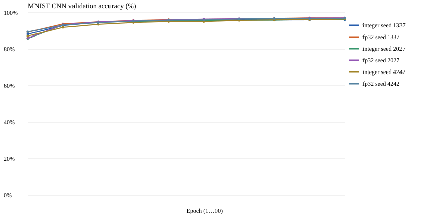

# MNIST CNN — frozen 10-epoch paired validation study, October 24, 2026

**Status:** Completed full-size **validation-only** study for [issue #35](https://github.com/philsupertramp/integers/issues/35), implementation [PR #36](https://github.com/philsupertramp/integers/pull/36). These scores are from the **5,000-image training-derived validation split**, **not** the official 10,000-image MNIST test partition. Training executable commit: `ce1e9975b0d3ca7ca98e1a54548cb9f32be4cf02`. The original model/data protocol was frozen before these measurements.

## Raw evidence

The following submitted outputs are preserved **byte-for-byte**, with no renormalization, rounding or rewriting of JSON results: `integer-seed-{1337,2027,4242}.json`, `fp32-seed-{1337,2027,4242}.json`, [manifest.json](manifest.json), [summary.md](summary.md), and [validation_accuracy.svg](validation_accuracy.svg). Each per-run JSON includes all ten epochs, online training accuracy, validation accuracy, confusion matrix and recall per class, reported anomaly fields, wall time and whole-process VmHWM RSS.



[experiment-files.tar.xz](experiment-files.tar.xz) is a lossless repackaging of the maintainer-provided `cnn-experiment-results.tar.gz`, preserving these same nine source files **plus the original 45 KB `cnn-training.log`**. It extracts under `reports/cnn-experiment/mnist/cnn/validation-only/` with the log at the archive root. Extract from the repository root with:

```sh
tar -xJf reports/held_out/mnist/cnn/validation-only/2026-10-24-10epoch-ce1e9975/experiment-files.tar.xz
```

- Submitted source tar.gz SHA-256: `90a48281dfc72e87f84ca238233d9150d343a34a911c7354622dd296edcbb347`
- Losslessly repackaged tar.xz SHA-256: `9e88d474bd88832a33d660068db64eafcbf65c08127be411eebf39863fc39cd4`
- All nine browsable raw-file Git blob hashes matched the local extracted sources exactly at the time of archival.

## Frozen protocol and provenance

- MNIST source **60,000 training IDX images**, canonical stratified **55,000 train / 5,000 validation** split. No official test files opened, hashed or evaluated; all six reports have `test_size=0`, `test_evaluated=false`.
- SHA-256 `train-images-idx3-ubyte`: `ba891046e6505d7aadcbbe25680a0738ad16aec93bde7f9b65e87a2fc25776db`.
- SHA-256 `train-labels-idx1-ubyte`: `65a50cbbf4e906d70832878ad85ccda5333a97f0f4c3dd2ef09a8a9eef7101c5`.
- Three paired model seeds: **1337, 2027, 4242**; **10 fixed epochs**, batch **32**, `lr_shift=7`, `momentum_shift=1`, integer scale shift **7**, gradient clip mantissa **8192**. No epoch/checkpoint selection or tuning based on final-test results.
- Architecture: Conv(1→4, valid 3×3), ReLU, 2×2 max-pool, Conv(4→8, valid 3×3), ReLU, 2×2 max-pool, Flatten(200), Dense(64), ReLU, Dense(10) logits, minimizing `0.5 * sum((logits-one_hot)^2)`.
- Manjaro `Linux-6.12.95-1-MANJARO-x86_64-with-glibc2.43`; Rust `rustc 1.95.0 (59807616e 2026-04-14)`, Cargo 1.95.0, release profile.

## Final validation results (epoch 10)

| Seed | Integer accuracy | FP32 accuracy | Difference | Integer wall | FP32 wall |
| ---: | ---: | ---: | ---: | ---: | ---: |
| 1337 | 96.14% | 97.12% | 0.98 pp | 477.68 s | 111.25 s |
| 2027 | 96.42% | 97.18% | 0.76 pp | 537.54 s | 116.03 s |
| 4242 | 96.54% | 96.98% | 0.44 pp | 550.99 s | 112.11 s |
| **Mean** | **96.37%** | **97.09%** | **0.73 pp** | **522.07 s** | **113.13 s** |

Mean peak process RSS: integer **410.80 MiB**, FP32 **410.65 MiB**. Integer wall time is ~**4.62×** this **unoptimized scalar FP32 reference** on this machine: it is *not* an inherent integer-versus-float throughput or Raspberry Pi 5 efficiency measurement.

Across all 60 backend-epochs, the reported output anomaly fields `extreme_outputs` and `nonfinite_outputs` were zero, but **no per-operation overflow/saturation, rounding-to-zero or gradient-loss counters were collected**. The integer model continued improving through epoch 10; there is no demonstration of complete training convergence/plateau or exact numerical equivalence. See the future [numerical-observability issue #37](https://github.com/philsupertramp/integers/issues/37).

## Reproduce this protocol

```sh
python3 experiments/fetch_mnist.py --data-dir data/mnist --train-only
python3 experiments/run_baselines.py \
  --dataset mnist --architecture cnn --validation-only \
  --epochs 10 --seeds 1337 2027 4242 \
  --batch-size 32 --lr-shift 7 \
  --output-dir reports/cnn-experiment
```

The original archived `manifest.json` identifies the precise training commit and source hashes. A future **final-test** run is a **separate experiment**: the official MNIST test set was already consumed for dense MLP issue #15 and cannot be described as a pristine untouched holdout for CNN tuning. Keep the result and provenance archives separate. No dataset, model checkpoint or weights are committed.
