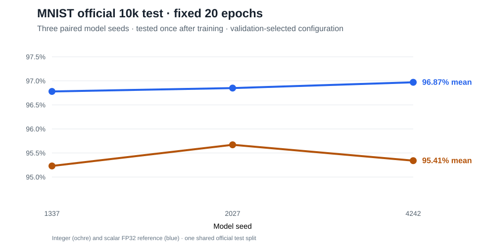

# Official MNIST held-out evaluation — fixed 20 epochs, October 24 2026

**Status: the previously predeclared [final-test protocol](../../../../../docs/MNIST_FINAL_PROTOCOL.md) has been executed.** These are actual scores on **all 10,000 official test images**, not validation or smoke results. The six submitted original per-model reports, the original `manifest.json`, and the original `summary.md` have been archived unchanged. **No test-driven hyperparameter changes, extra training, or model-selection steps have been applied to these submitted results.**

The local user executed the candidate at commit `fa405deeab3d7e456f50a407930f2a7b46673eb4` with `rustc 1.95.0 (59807616e 2026-04-14)` on `Linux-6.12.95-1-MANJARO-x86_64-with-glibc2.43`; the protocol had been frozen in the repository *before* this final run. Both canonical source training IDX hashes match [the earlier 20-epoch validation-only experiment](../../validation-only/2026-10-24-20epoch-0dcf0a3a/manifest.json). The original manifest additionally records SHA-256 of the two official test IDX files.

## Locked model and dataset

- Two backends: integer-native dyadic forward/backward/updates vs **independent, unoptimized scalar FP32 reference** with matching architecture, initial weights and example order.
- Model `784→128→128→10`, 20 **fixed** epochs, minibatch **32** with actual-sample mean gradients, `lr_shift=7`, `momentum_shift=1`, `quantization_shift=7`, `output_bits=31`, `grad_clip_mantissa=8192`.
- Fixed stratified development split **55,000 train / 5,000 validation** from the original 60k training source. The **independent 10,000-image official MNIST test** was evaluated *once per backend and seed after training*, without checkpoint selection.
- Paired model seeds **1337, 2027, 4242**. All six JSON reports explicitly record 10,000 test images evaluated, test-correct counts, test accuracy, full 20-epoch validation curves, per-epoch validation confusion matrices, wall time and process peak RSS.

## Official 10k test results

| Backend | Three-seed mean test accuracy | Range | Mean run wall time | Mean peak whole-process RSS |
|---|---:|---:|---:|---:|
| **Integer** | **95.41%** | 95.23–95.67% | 1387.95 s | 434.06 MiB |
| FP32 reference | **96.87%** | 96.78–96.97% | 341.14 s | 434.10 MiB |

FP32 exceeds the integer backend by **1.45 percentage points** in paired mean official test accuracy. Integer execution is **4.07× slower than the deliberately scalar, unoptimized FP32 reference on this machine**. This measures implementation maturity and the current scalar CPU paths, **not** an inherent architectural integer-versus-floating-point throughput result or an energy-efficiency comparison. Similar process RSS includes the in-memory training and test datasets.

| Seed | Integer official test | FP32 official test | FP32 advantage | Integer wall | FP32 wall |
|---:|---:|---:|---:|---:|---:|
| 1337 | 95.23% | 96.78% | 1.55 pp | 1573.42 s | 356.28 s |
| 2027 | 95.67% | 96.85% | 1.18 pp | 1293.68 s | 336.91 s |
| 4242 | 95.34% | 96.97% | 1.63 pp | 1296.76 s | 330.24 s |

## Validation versus independent test

The *same* fixed configuration previously obtained integer **94.76%** mean and FP32 **96.67%** mean on the 5,000-image **development validation** split. Here official test scores are **95.41%** and **96.87%** respectively: 0.65 and 0.20 percentage points above validation. Different source partitions can have different difficulty and finite-sample variation; this **does not** indicate data leakage. Do not use the test advantage or individual test errors to tune a rerun.

The models reused the **same 10,000 official test images across all three seeds**. This is **three trained models**, *not* 30,000 independent test examples. Each JSON records per-epoch **validation** confusion matrices, **not** test-set confusion matrices. Do not attribute digit-specific official-test errors using validation-only matrices.

All recorded validation epochs had zero `nonfinite_outputs` and `extreme_outputs`; FP32 also reported zero non-finite parameters. These diagnostics support observed training stability but do not prove numerical correctness of other APIs.

## What this proves and does not prove

**Measured:** useful integer-only dyadic *dense MLP* training on full MNIST, three reproducible model seeds, official held-out generalization scores, FP32 comparator, full curves, compute and RSS, independently reviewed file provenance.

**Not established:** exact FP32 accuracy parity, hardware speed/energy advantage, all library layers' integer-only boundary (see #26 for experimental float BatchNorm/Softmax), correctness on AArch64 Raspberry Pi 5, or approved numerical acceptance thresholds (ADR-004).

**Governance:** issue [#15](https://github.com/philsupertramp/integers/issues/15) has completed its experimental measurement requirements. Draft [PR #34](https://github.com/philsupertramp/integers/pull/34) awaits maintainer review/approval before merging into `big-refactor`. No permission to merge [PR #9](https://github.com/philsupertramp/integers/pull/9) into `master` is implied.

Original [manifest.json](manifest.json) and [summary.md](summary.md) retained for audit.
