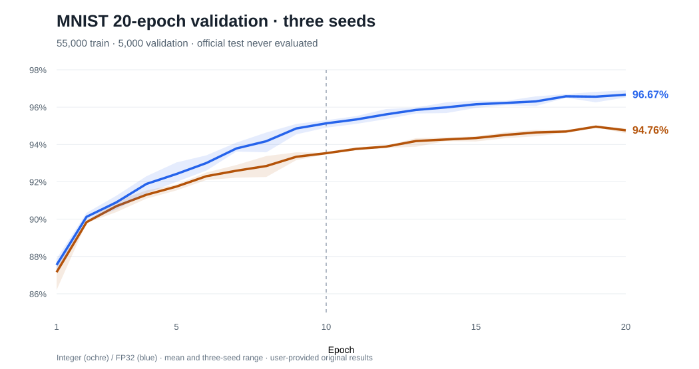

# MNIST 20-epoch full-size validation-only diagnostic · October 24, 2026

**Measured from six user-run local processes; no official MNIST test partition was opened, hashed or evaluated.**

- Original executable commit: `0dcf0a3af6b106565ea801b22c1ade3b499fc613`
- Runtime: `rustc 1.95.0 (59807616e 2026-04-14)` on `Linux-6.12.95-1-MANJARO-x86_64-with-glibc2.43`
- Protocol: official 60k **TRAINING IDX** source, stratified 55k actual train / 5k validation, model 784→128→128→10, batch size 32, LR shift 7, momentum shift 1, quantization shift 7, twenty **fixed** epochs; model seeds 1337, 2027, 4242.
- Data provenance: both exact training SHA-256 values in [manifest.json](manifest.json), matching [the preceding 10-epoch baseline](../2026-10-24-9b79a145/manifest.json).
- **Archival integrity:** six uploaded per-seed JSON learning curves, original `manifest.json` and `summary.md` are committed *without modifying their contents*. Analysis and visualization in this README/SVG are derived artifacts.
- Expected test metrics: all `test_size=0`, `test_evaluated=false`, `test_correct=null`, `test_accuracy_pct=null`. The 10×10 confusion matrices conserve 500 validation samples in each true-class row and reproduce all reported per-epoch accuracies.

## Full validation results after 20 epochs

| Backend | Mean validation accuracy | Min–max across 3 seeds | Mean wall time / run | Mean peak process RSS |
|---|---:|---:|---:|---:|
| Integer | **94.76%** | 94.60–94.86% | 1275.29 s | 410.55 MiB |
| FP32 scalar | **96.67%** | 96.52–96.90% | 332.18 s | 410.62 MiB |

The integer accuracy rose **1.23 percentage points** from its epoch-10 mean. FP32 rose **1.53 pp**. FP32's mean advantage increased from **1.60 pp at epoch 10** to **1.91 pp at epoch 20**. Integer averaged its highest score **94.95% at epoch 19**, while FP32's mean was highest at epoch **20**. These are *descriptive validation statistics*, not an independent final-test claim.

| Backend | Seed | Epoch-20 validation | Wall time | Peak RSS |
|---|---:|---:|---:|---:|
| fp32 | 1337 | 96.58% | 5.53 min | 410.51 MiB |
| fp32 | 2027 | 96.52% | 5.50 min | 410.77 MiB |
| fp32 | 4242 | 96.90% | 5.58 min | 410.57 MiB |
| integer | 1337 | 94.60% | 21.30 min | 410.57 MiB |
| integer | 2027 | 94.86% | 21.08 min | 410.57 MiB |
| integer | 4242 | 94.82% | 21.38 min | 410.50 MiB |

## Epoch-by-epoch mean validation

| Epoch | Integer | FP32 | Gap |
|---:|---:|---:|---:|
| 1 | 87.16% | 87.55% | 0.39 pp |
| 2 | 89.84% | 90.13% | 0.29 pp |
| 3 | 90.70% | 90.91% | 0.21 pp |
| 4 | 91.31% | 91.89% | 0.58 pp |
| 5 | 91.75% | 92.42% | 0.67 pp |
| 6 | 92.30% | 93.01% | 0.71 pp |
| 7 | 92.59% | 93.79% | 1.19 pp |
| 8 | 92.85% | 94.17% | 1.33 pp |
| 9 | 93.34% | 94.86% | 1.52 pp |
| 10 | 93.53% | 95.13% | 1.60 pp |
| 11 | 93.76% | 95.34% | 1.58 pp |
| 12 | 93.89% | 95.61% | 1.73 pp |
| 13 | 94.19% | 95.85% | 1.67 pp |
| 14 | 94.27% | 95.99% | 1.72 pp |
| 15 | 94.35% | 96.15% | 1.81 pp |
| 16 | 94.51% | 96.23% | 1.71 pp |
| 17 | 94.65% | 96.31% | 1.66 pp |
| 18 | 94.69% | 96.58% | 1.89 pp |
| 19 | 94.95% | 96.56% | 1.61 pp |
| 20 | 94.76% | 96.67% | 1.91 pp |

## Confusion-matrix findings

Matrices in each run are indexed `validation_confusion[actual_digit][predicted_digit]`; all digits have **500 validation examples per seed**, so aggregated class counts below are *1,500 model judgments* of the same **500 validation images across three seeds**, not 1,500 independent held-out images.

- Integer top confusion types: **4→9** (48), **7→9** (38), **5→3** (32), **3→2** (30), **8→3** (26).
- FP32 top confusion types: **3→2** (29), **7→9** (27), **4→9** (21), **5→3** (17), **9→4** (17).
- Class-wise recall (%) aggregated over the three model seeds:

| Digit | Integer | FP32 | Difference (FP32 − integer) |
|---:|---:|---:|---:|
| 0 | 96.80% | 98.20% | 1.40 pp |
| 1 | 98.20% | 98.47% | 0.27 pp |
| 2 | 93.80% | 96.33% | 2.53 pp |
| 3 | 94.07% | 95.80% | 1.73 pp |
| 4 | 95.00% | 97.60% | 2.60 pp |
| 5 | 93.00% | 96.13% | 3.13 pp |
| 6 | 96.73% | 97.93% | 1.20 pp |
| 7 | 94.07% | 95.67% | 1.60 pp |
| 8 | 92.80% | 95.73% | 2.93 pp |
| 9 | 93.13% | 94.80% | 1.67 pp |

Neither backend recorded non-finite or extreme outputs at any epoch; FP32 also reports no non-finite parameters. These are stability diagnostics, not independent proofs of general correctness. Runtime measures these particular implementations and is **not** an instruction-level hardware efficiency comparison.

## Next scientific step

We have two **predeclared**, fixed training budgets: ten and twenty epochs. The extra ten helped both architectures; this was a diagnostic, not a comprehensive MNIST hyperparameter search. Rather than repeatedly tuning on the same 5k validation examples, freeze the completed **20 epoch / batch 32 / LR shift 7 / model seeds 1337,2027,4242 / unchanged 784→128→128→10 model** as the final candidate. Run the official 10k-image MNIST test **exactly once** through the explicit `--final-test` gate, after recording the protocol and never adjusting based on the test result. The eventual ADR-004 release thresholds must be proposed for user approval, not inferred automatically.

See [issue #15](https://github.com/philsupertramp/integers/issues/15), [draft PR #34](https://github.com/philsupertramp/integers/pull/34), and [protocol](../../../../../docs/HELD_OUT_EXPERIMENTS.md).
