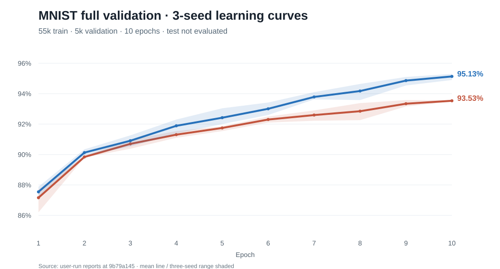

# Full-size MNIST validation-only baseline (24 October 2026)

**Status:** user-run original measurement on x86_64 Manjaro at commit `9b79a1450b51ab4cb2befb264bf8c1a8a4a75108`; archived unchanged alongside this README. **No official MNIST test files were loaded, read or hashed, and no test set was evaluated.** This is validation evidence, **not** a final held-out generalization claim.

The source training IDX checksums, platform, Rust version and timestamp are in [manifest.json](manifest.json). The original generated [summary.md](summary.md), and **all six unmodified per-seed reports** are retained here (integer/FP32 × model seeds 1337, 2027, 4242) with complete 10-epoch learning curves.

Protocol: full 60,000-image official *training* source, seeded stratified **55,000 training / 5,000 validation**, dense MLP `784→128→128→10`, batch size **32**, fixed **10 epochs**, effective batch-mean SGD LR `2^-7`, momentum shift 1, identical initial weights and data order for paired integer/FP32 runs.

## Validation results

- **Integer:** 93.53% mean, range 93.48%–93.56%; mean wall 12.08 min/run.
- **FP32 scalar reference:** 95.13% mean, range 94.90%–95.30%; mean wall 3.05 min/run.
- **Gap:** 1.60 percentage points in favor of FP32. The integer implementation was 3.96× slower than this independent scalar FP32 reference **on this implementation and machine**, not as an architectural hardware-efficiency verdict.
- Peak reported whole-process RSS ≈ 411 MiB for both; includes in-memory data. Zero non-finite or extreme outputs reported during all epochs; no extra numerical guarantee follows.

| Backend | Seed | Final validation | Wall time | Peak RSS |
| --- | ---: | ---: | ---: | ---: |
| integer | 1337 | 93.56% | 11.92 min | 410.57 MiB |
| integer | 2027 | 93.56% | 12.15 min | 410.80 MiB |
| integer | 4242 | 93.48% | 12.17 min | 410.58 MiB |
| fp32 | 1337 | 95.30% | 3.05 min | 410.59 MiB |
| fp32 | 2027 | 94.90% | 3.15 min | 410.66 MiB |
| fp32 | 4242 | 95.20% | 2.93 min | 410.55 MiB |

## Learning curves (mean of three fixed seeds)

| Epoch | Integer val | FP32 val | FP32 − integer |
| ---: | ---: | ---: | ---: |
| 1 | 87.16% | 87.55% | 0.39 pp |
| 2 | 89.84% | 90.13% | 0.29 pp |
| 3 | 90.70% | 90.91% | 0.21 pp |
| 4 | 91.31% | 91.89% | 0.58 pp |
| 5 | 91.75% | 92.42% | 0.67 pp |
| 6 | 92.30% | 93.01% | 0.71 pp |
| 7 | 92.59% | 93.79% | 1.19 pp |
| 8 | 92.85% | 94.17% | 1.33 pp |
| 9 | 93.34% | 94.86% | 1.52 pp |
| 10 | 93.53% | 95.13% | 1.60 pp |

**Interpretation:** both backends learned and the scores continued improving through epoch 10. The validation gap increased from 0.39 pp at epoch 1 to 1.60 pp at epoch 10. The sample is three random model seeds of one fixed train/val partition: these cannot estimate independent dataset variance and cannot attribute the gap to a specific arithmetic operation. Existing reports show *predicted class counts*, **not class-wise recall/error**; later diagnostics add confusion matrices.

## Next study (development-only; not tested here)

The next predeclared study may extend the same LR shift 7/batch 32 setup to 20 epochs with per-class confusion matrices. This is a **separate validation-only run** without any official test files. It should be used to understand learning-curve saturation and error patterns before freezing final evaluation parameters. Avoid tuning to or opening the official test set during experimentation. ADR-004 pass/fail thresholds remain a maintainer decision after enough evidence.

See [issue #15](https://github.com/philsupertramp/integers/issues/15), [draft PR #34](https://github.com/philsupertramp/integers/pull/34), and [experiment protocol](../../../../../docs/HELD_OUT_EXPERIMENTS.md).
